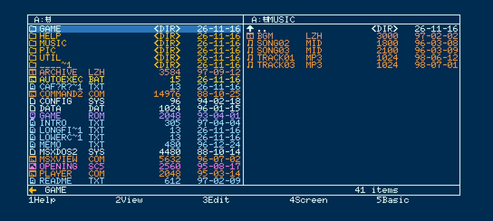
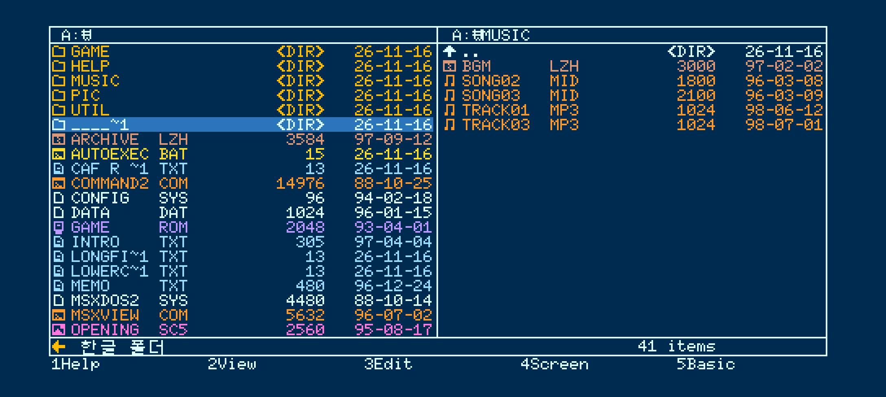
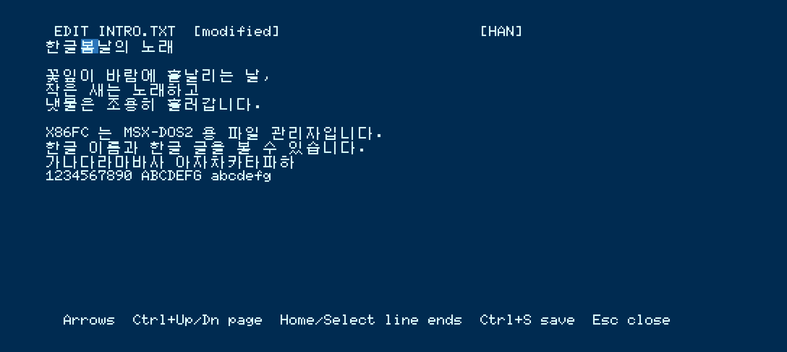
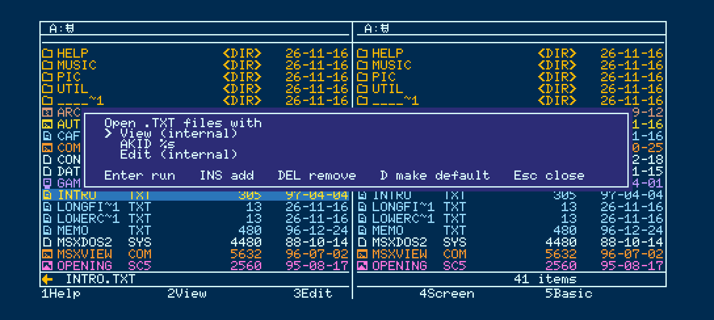

# X86FC — MSX-DOS2 / Nextor 용 파일 관리자

**x86 File Commander** · 두 패널 · 긴 파일 이름(VFAT) · 한글 · SCREEN 7

MSX-DOS2 / Nextor 에서 쓰는 `.COM` 파일 관리자입니다. Z80 어셈블리(pasmo)로 만들었고, 실행 파일(현재 0.12.50)은 **`X86FC.COM` + `X86FC.OVL` + `X86FC.INI` 세 개**입니다.

- 만든이: KimTaeWoo
- 라이선스: GPL-3.0-or-later (`LICENSE`). 한글 글꼴 Galmuri9(OFL)는 `release/Galmuri_OFL_LICENSE.txt` 참고
- 필요한 것: MSX2 이상 + MSX-DOS2 또는 Nextor



## 특징

### 파일 작업
- 복사(INS) · 이동(SELECT) · 삭제(DEL) · 이름 바꾸기(F6) · 폴더 만들기(F7)
- 폴더 통째로 복사·이동·삭제, 날짜·시간·속성 보존, 같은 이름이면 덮어쓰기 질문
- 윈도에서 만든 **긴 파일 이름(VFAT)** 을 읽고, 복사·이동·이름 바꾸기 때 그대로 보존
- 모든 질문과 입력은 화면 가운데 팝업 창
- 앞글자를 치면 그 이름으로 이동, Space 선택, Ctrl+A 모두 선택

### 화면 세 가지 (F4 로 바꿈)
- **글자 화면(SCREEN 0)**: 가장 빠름, 24줄
- **SCREEN 7**: 확장자별 아이콘과 색, 목록 22줄
- **SCREEN 7 한글(7H)**: 한글 파일 이름과 한글 글, 목록 20줄
- 시작 옵션: `X86FC /0`(글자) `/7` `/7H`

### 한글 (7H)
- 한글 파일·폴더 이름은 목록 아래 정보 줄에 긴 이름으로 표시(목록 자체는 8.3 이름)
- **F2 보기**: UTF-8 / EUC-KR 한글 자동 판별
- **F3 편집기**: 한글 입력(두벌식, MSX 한/영 키), UTF-8 로 저장, EUC-KR 파일은 열 때 UTF-8 로 변환해 편집하고 EUC-KR 로 되돌려 저장
- 이름 바꾸기·폴더 만들기·삭제 확인 창에서도 한글 이름 입력/표시
- 한글 글꼴은 Galmuri9(OFL) 9x9 점글꼴이며 `X86FC.OVL` 안에 들어 있습니다.




### 프로그램 실행하고 돌아오기
- Enter 로 COM·BAT 실행, 끝나면 같은 폴더·같은 줄로 자동 복귀
- `/` 명령줄(DOS 내부 명령도 가능, ↑↓ 로 지난 명령)
- F5: MSX-BASIC 으로 갔다가 `CALL SYSTEM` 하면 X86FC 로 자동 복귀
- ESC: 처음 DOS 화면을 잠깐 보고 다시 ESC 로 자동 복귀

### 파일 연결 (`X86FC.INI`)
```
확장자 = 프로그램 %s
HLP = #VIEW             ; 내부 텍스트 보기 (#EDIT = 내부 편집기)
MID = X86MIDI %s;MIDRY /I51 %s   ; ; 로 이으면 Enter 때 풀다운에서 선택
```
Ctrl+F3 으로 화면에서 바로 추가·삭제·기본 지정할 수 있습니다.



### 압축 파일 (목록 보기 + 풀기)
- 연결된 프로그램이 없는 압축 파일에서 Enter 를 누르면 내용 목록이 뜹니다(확장자가 아니라 파일 앞부분 서명으로 판별).
- 지원 형식: **LZH/LHA**(lh0, lh5), **ZIP**(저장, deflate, 32KB 창은 매퍼 쪽이 충분할 때), **ARJ**(방식 0~3), **PMA**(pm0)
- Space 로 표시, A 또는 Ctrl+A 로 전체 표시, Enter 로 반대편 패널 폴더에 풀기. 하위 폴더는 만들면서 풀고, CRC 검사, 날짜·시간 보존, 덮어쓰기 질문, ESC 중단을 지원합니다.
- 풀기는 편집기가 쓰는 **매퍼 쪽**을 사전·표로 씁니다(여유 쪽이 없으면 안내 팝업).

### F3 편집기
- 찾기(Ctrl+F, F3/Ctrl+N 다음), 바꾸기(Ctrl+R, 하나씩/전부), 줄 이동(Ctrl+G), 줄:칸 표시
- 블록 선택(Shift+방향키, Ctrl+B), 복사·잘라내기·붙여넣기(Ctrl+C/X/V), 줄 삭제(Ctrl+Y)·복제(Ctrl+D), 되돌리기(Ctrl+Z)
- 큰 파일(수십~수백 KB)은 창 단위로 읽고 쓰며 편집합니다(저장 때 파일 크기만큼 디스크 여유가 필요).

### 찾기 · 트리 · 바로가기
Ctrl+F 파일 찾기(하위 폴더까지, `* ?`) · Ctrl+W 폴더 트리 · Ctrl+B 자주 가는 폴더 · Ctrl+G 사용자 메뉴 · F9 드라이브 · F8 정렬

## 키 요약
| 키 | 동작 |
|---|---|
| F1 / F2 / F3 | 도움말 / 보기 / 편집 |
| F4 / F5 | 화면 방식 / BASIC |
| Shift + F1~F5 | F6 이름 바꾸기 · F7 폴더 만들기 · F8 정렬 · F9 드라이브 · F10 끝 |
| INS / SELECT / DEL | 복사 / 이동 / 삭제 |
| Space / Tab | 선택 / 패널 전환 |
| Ctrl+F / W / B / G | 찾기 / 트리 / 바로가기 / 사용자 메뉴 |
| Ctrl+F3 | 연결 프로그램 관리 |

## 설치
`release/` 의 `X86FC.COM`, `X86FC.OVL`, `X86FC.INI` 를 같은 폴더에 넣고 `X86FC` 를 실행합니다. 설정(화면 방식, 정렬, 메뉴, 바로가기, 명령줄 기록)은 모두 `X86FC.INI` 한 파일에 저장됩니다.

## 소스 빌드
[pasmo](https://pasmo.speccy.org/) 와 Python 3 이 필요합니다.

```
cd src
pasmo -d x86fc.asm X86FC.COM          # 본체
python3 ../tools/mkovl.py .            # 오버레이+글꼴 -> 실행파일/X86FC.OVL (글꼴 hgl.bin 은 src 에 포함)
```
이 저장소의 소스로 빌드한 `X86FC.COM`·`X86FC.OVL` 은 `release/` 의 파일과 바이트 단위로 같습니다(확인함).
- `src/x86fc.asm` 본체, `src/s7.inc` SCREEN 7·7H 그리기, `src/hang.inc`·`hanin.inc` 한글 표시·입력, `src/ini.inc` INI 읽기·쓰기, `src/ov_*.inc` 오버레이 모듈(`ovl.cfg` 에 설정)
- `tools/mkhgl.py` 는 Galmuri9 BDF 에서 한글 글꼴 `hgl.bin` 을 만드는 스크립트입니다.
- 코드와 작업 영역이 TPA 안에 빠듯하게 들어가므로 빌드 결과의 `BSS_END` 가 `D000h` 를 넘지 않게 주의하세요(넘으면 폴더 복사 버퍼가 모자라 시험이 깨집니다).

## 확인한 환경과 한계
- 에뮬레이터(MSX2, MSX-DOS 2.20)에서 모든 기능을 시험했고, 실기(FS-A1GT turboR + Nextor)에서는 프로그램 실행 복귀, 한글 이름 표시, 긴 이름 표시, 풀다운, 파일 연결 저장을 확인했습니다.
- 한/영 키 입력, F3 한글 편집, F5(BASIC) 복귀, 가는 선 틀도 실기에서 확인했습니다.
- 압축 풀기, 편집기 찾기/바꾸기/되돌리기/큰 파일은 에뮬레이터에서 바이트 비교로 시험했고, 실기(turboR)에서 풀기와 편집기가 잘 동작하는 것을 확인했습니다.
- 한 폴더 항목 최대 191개, FAT12/16. 편집기 복사 클립보드는 매퍼 쪽이 있으면 최대 14KB, 없으면 760바이트.
- 압축: LZH lh1·lh6·lh7, PMA pm1·pm2, 암호 압축·deflate64·bzip2 는 풀지 못합니다. 128KB 기종(CPC-400 급)은 매퍼 쪽이 모자라 32KB 창 ZIP 을 풀지 못할 수 있습니다.

의견과 오류 제보 환영합니다.
